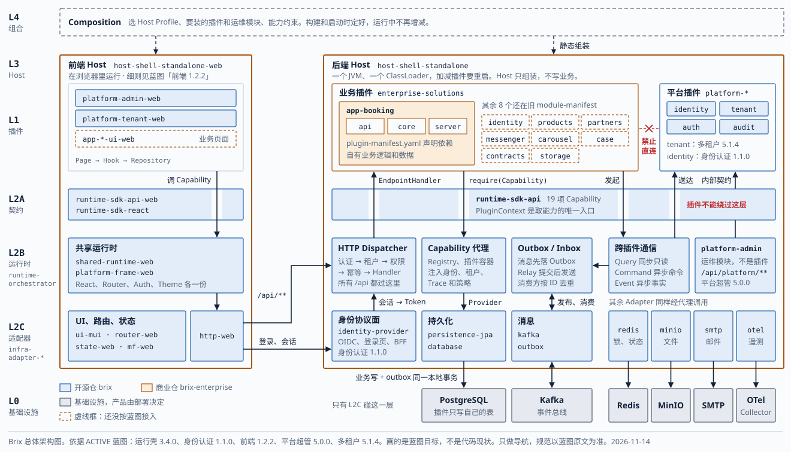

# Brix Enterprise 文档入口

想知道现在按哪份文档开发，看本页。本页只做导航，不是规范。蓝图是否生效以 [architecture-baselines.lock.yaml](architecture-baselines.lock.yaml) 为准，本页与它不一致时以它为准。

本页没有列出的文档都不作施工依据。不要靠文件头判断蓝图是否生效：旧版蓝图的内容被哈希锁定，有的状态行还写着 `ACTIVE`。

## 当前生效的蓝图

| 领域 | 蓝图 | 版本 | 生效日期 | 实施状态 | 待重基线 |
|---|---|---|---|---|---|
| 运行壳（根） | [v3.3.0-运行壳架构设计蓝图.md](v3.3.0-运行壳架构设计蓝图.md) | 3.3.0 | 2026-10-28 | `non-conformant` | 否 |
| 身份认证 | [v1.0.1-身份认证功能最小实现-设计蓝图.md](v1.0.1-身份认证功能最小实现-设计蓝图.md) | 1.0.1 | 2026-10-28 | `pending` | 否 |
| 前端 | [v1.2.1-前端架构-设计蓝图.md](v1.2.1-前端架构-设计蓝图.md) | 1.2.1 | 2026-10-28 | `not-assessed` | 否 |
| 平台超管 | [v4.0.1-平台超管功能最小实现-设计蓝图.md](v4.0.1-平台超管功能最小实现-设计蓝图.md) | 4.0.1 | 2026-10-28 | `not-assessed` | 是 |
| 多租户 | [v5.1.3-多租户功能最小实现-设计蓝图.md](v5.1.3-多租户功能最小实现-设计蓝图.md) | 5.1.3 | 2026-10-28 | `pending` | 是 |

- 根蓝图优先。专项蓝图只细化自己的范围，不能放宽根蓝图。完整的权威顺序见根蓝图 §0.4。
- “生效”指架构规范生效，不代表代码已经按它实现完。实施状态取自注册表的 `implementationStatus`。
- 待重基线为“是”的蓝图仍然有效，但复核完成前不能据此宣称 Implementation Accepted 或 GA。
- 这五份蓝图的正文里还留着旧版本号，因为冻结文件不能改，要等下一版才能修。根蓝图 §0.6、附录 A、附录 B 写的专项版本是 1.0、1.2、4.0、5.0；超管、前端、多租户蓝图有 7 条链接指向旧版，旧版搬进 `docs/archived/` 后这些链接打不开，按文件名在那里能找到。当前版本以上表为准。

## 总体架构图



这张图把上面五份蓝图画到一起，帮助看懂结构。它不是规范，不作施工依据，与蓝图不一致时以蓝图为准。图是矢量的，字小就放大页面看。

- 怎么读：业务插件在中间，运行壳包在外面。请求由 L2B 送进插件；插件要用外部资源，只能穿过 L2A 这层的开口，最后由 L2C 碰到基础设施。箭头是运行时的调用方向；L1、L2B、L2C 的源码依赖都指向 L2A（根蓝图 §3.2）。
- 图上没画：Embedded 和 Local 两种 Host Profile，移动端（`*-mobile` 包，分层相同），以及在 CI 里检查红线的 `platform-devtools`。

图画的是蓝图目标，不是代码现状。到 2026-11-06 为止，代码和图还差这些：

- 后端 Host 装了 9 个业务插件，只有 `app-booking` 用 `plugin-manifest.yaml` 接入，其余 8 个还是旧的 `module-manifest.yaml`。
- 前端已有 `standalone-web.composition.ts`。后端还没有 Composition 文件，装什么由 Host 的 `pom.xml` 和 `application.yml` 决定。
- 前端 Host 现在只组合了 `platform-admin-web` 和 `platform-tenant-web`，业务 UI 还没接进来。

## 在用的施工方案

方案只安排施工，不创造架构决定；与蓝图冲突时以蓝图为准。

| 方案 | 现状 | 什么时候看 |
|---|---|---|
| [标准链路收尾](v3.3.0-运行壳-标准链路收尾-设计方案.md) | 在施工 | 想知道现在做到哪、接下来做什么：§11 是待办队列，§10 是施工记录 |
| [幂等记录与命令结果](v3.3.0-运行壳-幂等记录与命令结果-设计方案.md) | 在施工 | 标准链路第 7～10 点的设计 |
| [事件总线收敛到 Kafka](v3.3.0-运行壳-事件总线收敛到Kafka-设计方案.md) | 第一阶段和 Kafka 侧补全已完成；第二阶段（§12）暂停 | 查事件链路的设计；企业插件迁移时按 §12 恢复 |
| [同步查询通道标准化](v3.3.0-运行壳-同步查询通道标准化-设计方案.md) | Q1～Q11 已完成 | 查查询通道的设计；§9.2 的 RFC 建议排在标准链路 §11 |
| [通知送达语义](v3.3.0-运行壳-通知送达语义-设计方案.md) | D103～D108 已批准；D104、D107 已在标准链路第 14a 点施工，RFC-012 已在第 14b 点起草，其余在 §11.1 队列 | 查邮件怎么发、失败了怎么办；标准链路第 14 点 |
| [Bootstrap 会话交付](v3.3.0-运行壳-Bootstrap会话交付-设计方案.md) | D109～D113 已批准；RFC-013 已起草，过渡期豁免是下一步，施工在根 3.4.0 发布之后 | 查开 Bootstrap 会话为什么要改、推荐怎么改；标准链路 §11.1 单向门队列 |
| [身份认证 M1 实施计划](v1.0-身份认证功能最小实现-M1实施计划.md) | 切片 1～3 已部署，待负责人验收；切片 4 未完成 | 查托管登录和 BFF 的落地情况 |

`v3.1.3-多租户功能最小实现-开发落地计划（v4.0）.md` 不在上表。它依据的蓝图已退役，根蓝图登记它需要复核，不作施工依据。它留在 `docs/` 只因为根蓝图 §0.6、附录 A、附录 B 还写着这个文件名。

## RFC

RFC 是决策背景，不指导施工；已裁决的条款以当前蓝图正文为准。文件名都带“（Draft）”，但只有 RFC-009～RFC-013 还是草稿。

| RFC | 主题 | 状态 |
|---|---|---|
| [RFC-001](rfc/RFC-001-运行壳-持久化抽象与数据库可移植性（Draft）.md) | 持久化抽象与数据库可移植性 | 已并入根蓝图 v3.1.0 |
| [RFC-002](rfc/RFC-002-身份认证-统一登录架构与认证专项（Draft）.md) | 统一登录架构与认证专项 | 已并入根蓝图 v3.2.0 和身份认证、超管、多租户、前端专项 |
| [RFC-003](rfc/RFC-003-多租户-租户最小RBAC授权模型（Draft）.md) | 租户最小 RBAC 授权模型 | 已裁决，已并入 multi-tenant 5.1 |
| [RFC-004](rfc/RFC-004-多租户-成员邀请的发起人（Draft）.md) | 成员邀请的发起人 | 已裁决，已并入 multi-tenant 5.1.1 |
| [RFC-005](rfc/RFC-005-多租户-全局表清单与跨租户访问登记（Draft）.md) | 全局表清单与跨租户访问登记 | 已裁决，已并入 multi-tenant 5.1.2 |
| [RFC-006](rfc/RFC-006-运行壳-提前停用三个跨租户L2A方法（Draft）.md) | 提前停用三个跨租户 L2A 方法 | 已批准 |
| [RFC-007](rfc/RFC-007-运行壳-提前停用两个按contextId查找的L2A方法（Draft）.md) | 提前停用两个按 contextId 查找的 L2A 方法 | 已批准 |
| [RFC-008](rfc/RFC-008-运行壳-受托写入登记与策略审计写入器（Draft）.md) | 受托写入登记与策略审计写入器 | 已批准，已并入根蓝图 v3.3.0 |
| [RFC-009](rfc/RFC-009-运行壳-命令幂等的请求指纹、结果与状态（Draft）.md) | 命令幂等的请求指纹、结果与状态 | 草稿，批准前不指导施工；审批排在标准链路 §11 末尾 |
| [RFC-010](rfc/RFC-010-运行壳-先做访问检查再校验请求（Draft）.md) | Dispatcher 先做访问检查、再校验请求 | 草稿，批准前不指导施工；负责人已同意方向，审批与 RFC-009 一起排在标准链路 §11.1 |
| [RFC-011](rfc/RFC-011-多租户-运维模块经内部契约读取租户数据（Draft）.md) | 运维模块经内部契约读取租户数据 | 草稿，批准前不指导施工；负责人已同意方向，审批与 RFC-009、RFC-010 一起排在标准链路 §11.1 |
| [RFC-012](rfc/RFC-012-运行壳-通知的送达语义（Draft）.md) | 通知的送达语义 | 草稿，批准前不指导施工；负责人已同意方向，审批与 RFC-009～RFC-011 一起排在标准链路 §11.1 |
| [RFC-013](rfc/RFC-013-超管-Bootstrap会话交给BFF（Draft）.md) | Bootstrap 会话交给 BFF | 草稿，批准前不指导施工；负责人已同意方向，审批与 RFC-009～RFC-012 一起排在标准链路 §11.1 |

## 治理记录

| 文件 | 内容 |
|---|---|
| [architecture-baselines.lock.yaml](architecture-baselines.lock.yaml) | 蓝图注册表：所有版本的状态、内容哈希和批准记录 |
| [architecture-exemptions.json](architecture-exemptions.json) | 临时豁免，到期后校验失败 |
| [CHANGELOG-runtime-shell.md](CHANGELOG-runtime-shell.md) | 根蓝图变更记录 |
| [CHANGELOG-architecture-specialized.md](CHANGELOG-architecture-specialized.md) | 专项蓝图变更记录 |
| `architecture-freeze-evidence/` | 各版本的冻结证据 |
| `phase0-evidence/` | Phase 0 环境与供应链证据 |

在仓库根目录校验当前基线：

```bash
python3 scripts/validate_architecture_baseline.py --require-active --check-instructions
```

## 其他资料

开发参考资料见 [docs-dev/README.md](../docs-dev/README.md)。历史文档放在 `docs/archived/`，只用于追溯，不指导开发；该目录的 `README.md` 是历史文档索引。

## 维护规则

- 蓝图发布新版本时，同一次提交做四件事：用 `git mv` 把旧版搬进 `docs/archived/`，更新本页的蓝图表，在该目录的 `README.md` 登记，在变更日志里写上新版本的完整 SHA-256。漏了任何一件，校验器都会失败。
- 方案开工、暂停或关闭时，更新“在用的施工方案”。这张表校验器不检查。
- 蓝图发布新版本，或者图上的虚线框接入后，更新 `architecture-overview.svg` 和“总体架构图”一节。这张图是手画的，校验器只检查文件存在，不检查内容。
- 其他文档不再使用时，搬进 `docs/archived/` 并保留原文件名，在该目录的 `README.md` 登记。
- 本页不链接退役蓝图和 `docs/archived/` 下的文档（根蓝图 `BRX-RS-AUTH-007`），校验器会检查。
