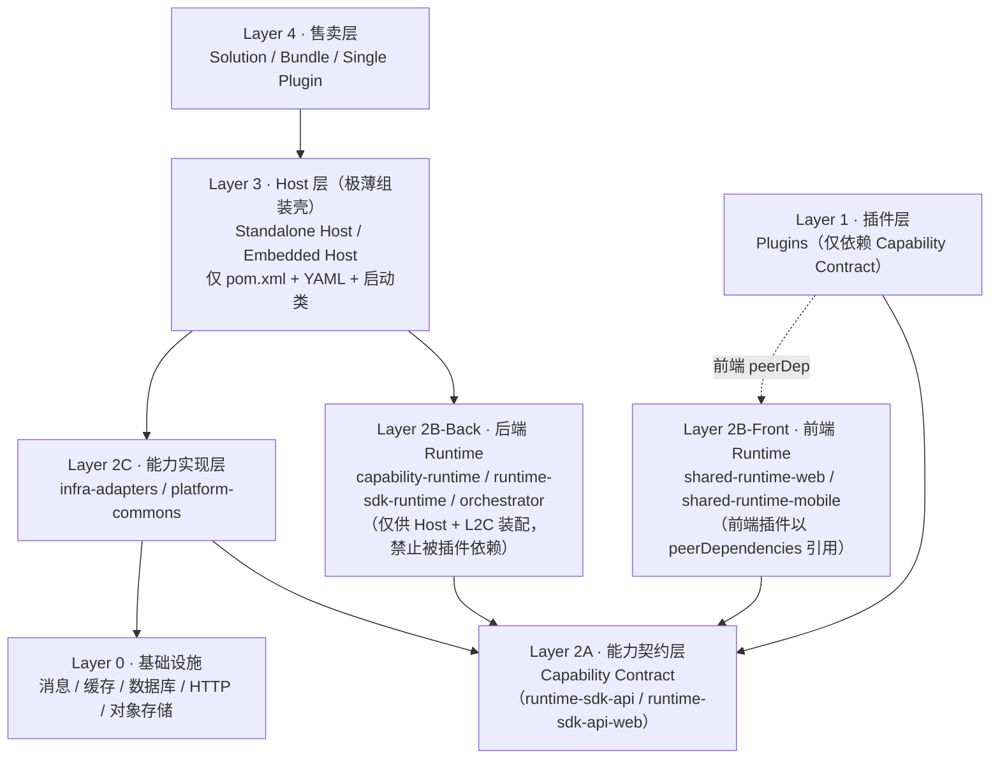
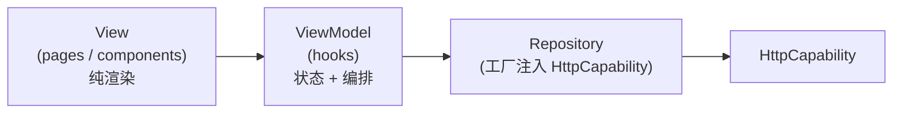

# Brix Platform v3.0.10：运行壳（Runtime Shell）架构设计蓝图

> **版本**: v3.0.10  
> **日期**: 2026-04-26  
> **状态**: 蓝图（Blueprint，承载稳定契约与设计方向）  
> **作者**: Brix Platform Architecture Team  
> **历史变更**: 见 [CHANGELOG-runtime-shell.md](./CHANGELOG-runtime-shell.md)

---

## 0. 文档定位与读者指引

本文档是 Brix Platform 运行壳的 **唯一蓝图来源（Single Source of Truth）**。

蓝图只承载 **稳定的、契约性的、与具体业务无关的内容**：

| 要素 | 章节 | 含义 |
|------|------|------|
| 设计原则（Why） | §1 | 解释"为什么这么设计" — 哲学层 |
| 设计约束（How the system works） | §2 | 描述"系统如何工作" — 结构层 |
| 架构分层（Layer Model） | §3 | 平台分层与依赖方向 |
| 能力契约（Capability Contract） | §4 | Runtime Shell 暴露给插件的稳定接口集合 |
| 插件模型（Plugin Model） | §5 | 插件的形状、清单、生命周期 |
| 事件模型（Event Model） | §6 | 平台事件分类与流转 |
| Host 规范（Ultra-Thin Host） | §7 | 宿主形态与极薄约束 |
| UI Runtime（Frontend Runtime） | §8 | 前端运行时与跨插件 UI 契约 |
| 售卖模型（Commercial Model） | §9 | 商业组合的抽象维度（不绑定行业） |
| 架构红线（Red Lines） | §10 | 不可违反的硬约束 + 机器化校验 |

### 0.1 蓝图边界（什么不在蓝图里）

| 内容 | 去向 |
|------|------|
| 历史版本日志 | [CHANGELOG-runtime-shell.md](./CHANGELOG-runtime-shell.md) |
| 多租户身份与隔离的具体设计 | [v3.0-多租户架构蓝图.md](./v3.0-多租户架构蓝图.md)（业务子领域蓝图） |
| 高可用与容灾设计 | [v1.0-高可用与容灾架构设计.md](./v1.0-高可用与容灾架构设计.md)（占位） |
| ArchUnit / ESLint 规则实现代码 | `architecture-guard` / `eslint-config-architecture` 模块 |
| 数据库厂商策略、区域化部署、运维参数 | 部署架构文档（独立维护） |
| 行业解决方案（医疗、零售、金融等） | 各自解决方案文档，不进入本蓝图 |
| 实施路线图、待讨论问题 | `docs/roadmap-runtime-shell.md` / GitHub Issues |

### 0.2 示例占位符约定

蓝图中所有示例代码 / 配置 / 仓库目录，均使用以下占位符，**不代表平台预置的真实业务**：

| 占位符 | 含义 |
|--------|------|
| `app-{name}` | 任一业务插件目录 |
| `plugin-{name}` | 任一插件 jar / 模块 |
| `{name}-api / -core / -server / -shared / -ui-web / -ui-mobile` | 插件六段式分层 |
| `Example*` / `Entity*` | 任一业务类型 |
| `useEntity*()` | 任一前端 hook |

---

## 文档目录

- [0. 文档定位与读者指引](#0-文档定位与读者指引)
- [1. 设计原则](#1-设计原则)
- [2. 设计约束](#2-设计约束)
- [3. 架构分层](#3-架构分层)
- [4. Runtime Shell 能力契约](#4-runtime-shell-能力契约)
- [5. 插件模型](#5-插件模型)
- [6. 事件模型](#6-事件模型)
- [7. Host 极薄设计规范](#7-host-极薄设计规范)
- [8. UI Runtime 架构](#8-ui-runtime-架构)
- [9. 插件组合与售卖模型](#9-插件组合与售卖模型)
- [10. 架构红线](#10-架构红线)
- [关联蓝图](#关联蓝图)
- [附录 A：术语表](#附录-a术语表)
- [附录 B：参考资料](#附录-b参考资料)
- [附录 C：红线变更治理流程](#附录-c红线变更治理流程)

---

## 1. 设计原则

> 设计原则解释 **"为什么这么设计"**。原则演进极慢，是哲学层共识。
> 原则 → 约束 → 红线，三者一脉相承：原则定方向，约束定结构，红线定边界。

| # | 原则 | 核心要义 |
|---|------|----------|
| **P-1** | Capability Contract 优先 | 插件只依赖 Capability 接口，永不依赖具体实现；Capability 是稳定契约；新增 Capability 须经架构评审 |
| **P-2** | 声明式优于命令式 | 事件订阅、插件组合、路由规则通过声明式 Manifest / YAML 定义，而非散落在代码中 |
| **P-3** | 基础设施隔离 | 插件代码中禁止出现任何基础设施依赖（消息中间件、缓存、HTTP Client、数据库驱动）；Runtime Shell 是唯一接触基础设施的层 |
| **P-4** | Host 极薄设计 | Host 是配置驱动的极薄组装壳；零实现代码、零业务逻辑；能力切换通过更换依赖 + 修改配置完成 |
| **P-5** | 事件驱动解耦 | 插件之间通过 Integration Event 异步通信，无直接调用；同步只读查询走 QueryCapability |
| **P-6** | 前后端完全分离 | 前端采用 View → ViewModel → Repository 三层；通过 `{name}-shared` 共享类型契约；UI 与后端可独立演进 |
| **P-7** | 可观测性内置 | 所有跨插件通信必须可追踪（Trace ID 透传）；Runtime Shell 负责埋点 |
| **P-8** | 渐进式演进 | 接口演进只能新增可选成员；破坏性变更必须按 [附录 C](#附录-c红线变更治理流程) 走 RFC |
| **P-9** | 开源 / 商业边界单向 | 开源层（OSS）不得依赖商业层；商业层可单向依赖开源层；保证开源仓的独立可发布 |

---

## 2. 设计约束

> 设计约束描述 **"系统如何工作"**。约束变更影响整体架构形态。
> 约束 ⊆ 原则的具象化；红线是约束的可机器化校验子集。

### 2.1 核心术语（速查）

> 完整术语见 [附录 A：术语表](#附录-a术语表)。

| 术语 | 定义 |
|------|------|
| **Runtime Shell** | 平台为插件提供的能力契约集合，屏蔽运行环境差异、基础设施实现和宿主形态 |
| **Capability Contract** | Runtime Shell 暴露的抽象接口，**插件唯一允许依赖的接口层** |
| **Host** | 极薄组装壳：仅含启动类 + 依赖声明 + YAML 配置 |
| **Plugin** | 最小可售卖、可组合的业务单元，仅依赖 Capability Contract |
| **Adapter** | 基础设施能力的具体实现（如消息适配器、缓存适配器） |

### 2.2 设计约束清单

#### C-1：Runtime Shell 是能力模型，不是具体系统

- 一组接口契约，不是框架、不是中间件、不是独立进程；
- 由不同 Host 组装具体实现（Host 本身不含实现代码）。

#### C-2：插件只依赖 Capability Contract

- 插件代码中禁止出现 Kafka / Redis / HTTP Client / 数据库驱动等基础设施依赖；
- 插件不得绕过 Runtime Shell 直接访问基础设施；
- Runtime Shell 是唯一允许接触基础设施的层。

#### C-3：Host 能力等价

- Standalone Host 与 Embedded Host 提供 **相同的 Capability 接口**；
- 区别仅在实现复杂度，不在功能可达性；
- 不允许为嵌入模式设计"特例架构"。

#### C-4：插件间通过事件解耦

- 插件之间互不感知，写操作只通过 Integration Event 通信；
- 插件声明"我能发布什么 / 我能订阅什么"，不写具体监听逻辑；
- Runtime Shell 负责事件路由与转换。

#### C-5：跨插件同步查询走 QueryCapability

- 同步只读查询通过 `QueryCapability` / `PluginQueryGateway`；
- 仅查询 ReadModel（CQRS 投影），禁止读取目标插件的写库；
- 所有调用必须带超时 / 熔断 / Trace ID。

#### C-6：Runtime Shell 复杂度对插件不可见

- 插件开发者只需了解 Capability Contract；
- 事件路由、数据持久化、跨插件调用，由 Runtime Shell 处理。

#### C-7：Host 极薄原则

- Host 项目仅包含：启动类 + 依赖声明（`pom.xml`）+ YAML 配置；
- **硬约束**：禁止出现 `@Service` / `@Configuration` / `@Bean` / `@Component` 类；禁止 if-else / 循环 / 数据转换业务逻辑；
- **软指标**：Host 启动类建议 < 30 行，超过触发 warning。

#### C-8：前后端完全分离

- 前端三层分离：View（pages / components）→ ViewModel（hooks）→ Repository；
- View 层为纯渲染层，禁止直接调用 fetch / axios；
- Repository 通过工厂模式注入 `HttpCapability`；
- `{name}-shared` 模块作为前后端类型契约（DTO、事件、权限常量）。

#### C-9：前端运行时唯一真相源

- 所有前端运行时依赖（React、Router、State、UI）必须从 `@brix-sdk/shared-runtime-web` 获取；
- 运行时依赖统一使用 `peerDependencies`；
- 版本由 `shared-runtime` 统一定义，消除版本碎片化。

> 与后端对比：后端通过 Maven BOM(`brix-bom`, §3.3.1)编译期统一版本；前端 Module Federation 是运行时动态加载，必须有统一的运行时提供者。

#### C-10：UI 组件统一治理（BrixUI）

- 平台插件**强制**通过 `useUI()` 获取 UI 组件；
- 插件 `dependencies` 中禁止直接出现第三方 UI 库（MUI / Ant Design 等）；
- UIAdapter 未覆盖的组件必须提交 RFC 扩展，而非旁路引入；
- 第三方插件（嵌入场景）建议但不强制。

> BrixUI 组件分层、逃生舱机制详见 [BrixUI 治理文档](./BrixUI-governance.md)（独立文档）。

#### C-11：开源 / 商业仓库单向依赖

- 开源仓（`brix/*`）不得 `import` 或 Maven 依赖任何商业仓（`brix-enterprise/*`）模块；
- 商业仓可单向依赖开源仓；
- 保证开源仓可独立编译、独立发布。

### 2.3 违反约束的后果

- 插件无法在不同 Host 间移植；
- 版本分裂、维护成本指数级增长；
- 架构腐化、平台治理失控；
- 开源仓被商业代码污染，无法独立发布。

---

## 3. 架构分层

### 3.1 分层模型



### 3.2 层次职责

| 层 | 职责 | 允许依赖 | 禁止依赖 |
|----|------|----------|----------|
| **L4 售卖层** | 商业组合声明（Solution YAML） | L3 | — |
| **L3 Host 层** | 装配，零实现代码 | L2C / L2A | L0、L1 |
| **L2C 能力实现层** | 实现 Capability 接口；接触基础设施 | L2A、L0 | L1、L3、L4 |
| **L2B-Back 后端 Runtime** | 后端运行时（CapabilityRegistry / Plugin 容器 / Outbox 投递器 / PluginQueryGateway / Capability AOP 拦截器） | L2A | L1、L3、L4、其他插件 |
| **L2B-Front 前端 Runtime** | 前端共享运行时（React / Router / State / UI 唯一来源） | L2A 前端契约 | L1、L3、L4、L2C、L2B-Back |
| **L2A 能力契约层** | 接口与 DTO，零实现 | — | 任何具体实现 |
| **L1 后端插件** | 业务后端(`-api / -core / -server`) | L2A、`{name}-shared`、自身模块 | **L2B-Back**、L0、L2C、其他插件具体实现 |
| **L1 前端插件** | 业务前端(`-ui-web / -ui-mobile`) | L2A 前端契约、L2B-Front (peerDep)、`{name}-shared`、自身模块 | L0、L2C、L2B-Back、其他插件具体实现 |
| **L0 基础设施** | 消息中间件、缓存、数据库、HTTP、对象存储等 | — | — |

> **L2B 拆分说明（v3.0.10 收敛）**：原 L2B 同时承载前端 `shared-runtime-*` 与后端 `capability-runtime` 两类资产，导致守护规则难以表达。本版本拆为：
> - **L2B-Back**：仅供 Host 与 Adapter 装配；后端插件**不得依赖**任何 L2B-Back 模块（A-21）；插件的后端 Capability 入口只来自 L2A `runtime-sdk-api`，运行期由 Host 注入。
> - **L2B-Front**：前端插件以 `peerDependencies` 引用（C-9 / A-19）；不参与后端依赖图；不得反向被 L2B-Back 依赖。
> - 二者的守护规则各自独立表达：A-21（后端） / A-19（前端）。

### 3.3 仓库映射（占位）

蓝图层面只声明"开源仓 / 商业仓"两个抽象仓位，具体仓名、子模块名由产品决定。

| 仓位 | 含义 | 主要内容 |
|------|------|---------|
| **开源仓** | OSS 可独立发布 | `brix-bom`、Capability Contract、Runtime SDK（L2B-Back）、infra-adapters、platform-commons、shared-runtime（L2B-Front）、devtools（架构守护） |
| **商业仓** | 商业增值，可单向依赖开源仓 | 企业级 Host、企业级业务插件、企业级 UI 框架、商业组合（Solution Pack） |

> 依赖方向：商业仓 → 开源仓；反向禁止（C-11 / A-12 红线）。

#### 3.3.1 后端版本统一（`brix-bom`）

为消除后端插件 / Host / Adapter 的版本碎片化，开源仓提供 **`io.brix:brix-bom`**（Maven BOM POM），统一管理：

- 平台模块（`runtime-sdk-api` / `platform-commons` / `infra-adapter-*` / `architecture-guard` / `query-client-codegen` …）的版本；
- 平台对外部库的版本约束（Spring Boot / Jackson / Micrometer / Flyway / spring-security-crypto 等关键依赖）。

约定：

- **所有 Host 与插件的根 `pom.xml` 必须 `dependencyManagement` 引入 `brix-bom`**；
- 插件 / Host 的 `dependencies` 段不得再写平台模块的 `<version>`；
- 商业仓的企业级 Host 同样依赖 `brix-bom`，不得自行覆盖关键依赖版本（如必须，需 RFC）；
- 与 C-9（前端 `shared-runtime`）形成对称：**后端 BOM 编译期统一 + 前端 shared-runtime 运行期统一**。

### 3.4 插件模块六段式

任一业务插件 `app-{name}` 推荐以下模块结构（具体名称由插件决定）：

| 模块 | 职责 | 层 | 补充约束 |
|------|------|----|---------|
| `{name}-api` | 对外契约、Capability 扩展接口 | L2A | 零实现 |
| `{name}-core` | 业务领域模型与逻辑 | L1 | **绝对禁止** `@RestController` / `@RequestMapping` / 任何传输层注解 |
| `{name}-server` | REST / gRPC 暴露 | L1 | **阶段性允许** `@RestController`（在 Runtime Endpoint Contract 成熟前）；仅能暴露本插件 API；禁止注入其他插件的 `*-core` / `*-server`；禁止绕过 `AuthCapability` / `ObservabilityCapability` / 多租户拦截；禁止直接接触基础设施 |
| `{name}-shared` | 前后端共享类型 / 事件 / 权限常量 | L1 | 零运行期依赖 |
| `{name}-ui-web` | Web 前端（View → ViewModel → Repository） | L1 | — |
| `{name}-ui-mobile` | Mobile 前端（同三层） | L1 | — |

> **未来演进**：Runtime Endpoint Contract / `@RuntimeEndpoint` + Endpoint Manifest 成熟后，A-1 将收紧 —— `{name}-server` 迁移到声明式端点，`@RestController` 全面禁用。

#### 3.4.1 类加载器隔离策略

v3.0.10 明确采用**单 ClassLoader**模型：

- 所有插件与 Capability 实现发布到 Host 的 `BOOT-INF/lib`（Spring Boot fat jar）或平铺 classpath；
- 依赖冲突由 `brix-bom`（§3.3.1）在编译期解决，**不依靠 ClassLoader 隔离**；
- 插件之间的事务 / 资源隔离由 PluginContext + Capability 边界保证，而不是类加载器；
- 多 ClassLoader / OSGi 式隔离被**明确延后**至后续版本，需独立 RFC；
- 收益：调试简单、类可见性不费解释、与 Spring Boot / Native Image 生态兼容；代价：由守护规则（A-21 / A-1 / A-2 / A-9）而非 JVM 隔离提供边界。

---

## 4. Runtime Shell 能力契约

### 4.1 Capability 分级(三维语义)

> 旧版“Core / Standard / Extended”将“接口归属”与“是否必选”混为一谈,易与事件可靠性级别(§6.2 CRITICAL/STANDARD/BEST_EFFORT)语义冲突。本版本将分级拆为三个**正交**维度:

| 维度 | 含义 | 取值 | 由谁决定 | 校验时机 |
|------|------|------|---------|---------|
| **(1) 接口归属** | Capability 接口是否由平台 Runtime Shell 定义 | `Platform Core` / `Plugin Extension` | 平台架构组(RFC) | 编译期(依赖 `runtime-sdk-api` 即可) |
| **(2) Host 必备性** | 当前 Host Profile 是否必须提供该 Capability 实现 | `Required` / `Optional` | Host Profile 配置 | **Host 启动期**(缺失则启动失败) |
| **(3) 插件必备性** | 单个插件是否声明运行所需该 Capability | `requires` / 不声明 | 插件 `plugin-manifest.yaml` 的 `capabilities.requires` | **Plugin Resolve 阶段**(缺失则该插件不上线,不影响其他插件) |

> **示例**:`SchedulerCapability` 接口属于 `Platform Core`(平台定义);某 `embedded` Host Profile 将其标为 `Optional`;插件 A 在 Manifest 中 `requires: [SchedulerCapability]`,在该 Host 启动时插件 A 会因依赖不满足而 **Resolve Failed，不进入 Ready，不参与流量**（符合 A-5 “独立启停”语义），Host 本身仍正常启动。

#### 4.1.1 平台定义的 Capability 集合(接口归属维度)

| 分类 | Capability 接口 |
|------|----------------|
| **基础设施类** | `EventBusCapability`、`HttpCapability`、`PersistenceCapability`、`StateStoreCapability`、`StorageCapability`、`LockCapability`、`SchedulerCapability` |
| **平台服务类** | `AuthCapability`、`PasswordCapability`（密码哈希 / 验证，BCrypt 默认实现）、`TenantCapability`（详见多租户蓝图）、`ConfigCapability`、`ObservabilityCapability`、`NotificationCapability`、`QueryCapability`、`IdGeneratorCapability` |
| **可选扩展类** | `SearchCapability`、`AnalyticsCapability`、`AdminCapability`(原生 SQL,需 RFC)、`ImpersonationCapability`（身份代理，**Platform Internal Only**，默认不对业务插件暴露，需 RFC + 安全审计，参见 S-9） |

> 上表只表示“接口由 Runtime Shell 定义”,**不表示“任何 Host 都必须实现”**——后者由 Host Profile 的“Host 必备性”维度决定。
>
> **Capability 接口语义版本**：每个 Capability 接口使用 `@CapabilityVersion("MAJOR.MINOR.PATCH")` 标注（SemVer）；Adapter 实现须声明其提供的版本。`CapabilityRegistry` 在 H-1 阶段校验：实现与契约 **Major 必须一致**，实现 Minor 必须 ≥ 契约 Minor，否则 Host 启动失败（与 A-20 向后兼容红线对齐）。

#### 4.1.2 启动期 Capability 校验

Host 启动期 `CapabilityRegistry` 严格按以下**阶段顺序**执行，任一阶段失败即按相应策略处理（后面阶段不再进入）：

```text
H-0 (Profile 防呆)
  → H-1 (Host Profile Required Capability 绑定)
     → H-2 (Adapter 可靠性 × 事件级别匹配)
        → H-3a (Solution required-capabilities 包含于 Host 实现集)
           → H-3b (Solution plugins.required 全部 Resolve 成功)
              → H-3c (Solution plugins.optional Resolve，允许单插失败)
                 → P-1 (非 Solution 范围插件 Resolve)
                    → P-2 (插件 Query 契约 typed client 编译期存在性)
                       → READY 状态 → 接入流量
```

| 阶段 | 校验内容 | 失败策略 |
|------|---------|---------|
| **H-0 Profile 性质校验** | 当前 Profile = `production` 时，禁止装载开发型 Adapter（`infra-adapter-inmemory` / H2 / mock auth / no-op observability / local file storage / fake notification / dev-only scheduler 等） | **Host 启动失败**（A-23） |
| **H-1 Host Profile 解析** | 当前 Host Profile 声明的 `Required` Capability 是否全部有 Adapter 绑定；**且 Adapter 提供的 `@CapabilityVersion` 与契约 Major 一致、Minor ≥ 契约** | **Host 启动失败**(fail-fast) |
| **H-2 Adapter 可靠性匹配** | 注解 `@IntegrationEvent(reliability = CRITICAL)` 的事件,绑定的 EventBus Adapter 必须支持 Outbox(§6.3) | **Host 启动失败**(A-10) |
| **H-3a Solution required-capabilities** | Solution YAML 中 `required-capabilities` 是否被当前 Host 满足（仅检查集合包含，不检查插件） | **Host 启动失败** |
| **H-3b Solution required plugins** | Solution YAML 中 `plugins.required` 列出的插件 Resolve 全部成功 | **Host 启动失败**（核心插件缺失 = 产品不完整，fail-fast）；Single Plugin Embedded 模式下当前插件视同 required |
| **H-3c Solution optional plugins** | Solution YAML 中 `plugins.optional` 列出的插件 Resolve | **该插件 Resolve Failed，不进入 Ready，不参与流量**；Host 正常启动 + 警告日志 + Metric 上报 |
| **P-1 Plugin Resolve** | 各插件 Manifest `capabilities.requires` 是否被当前 Host 满足 | **该插件 Resolve Failed，不进入 Ready，不参与流量**（不影响其他插件，符合 A-5）；Host 日志 + Metric 上报；若该插件位于 Solution `required` 列表则递升为 H-3b 处置 |
| **P-2 Plugin Query 契约** | 插件 `query.consumes` 声明的 typed client 接口在 classpath 中存在(由 codegen 保证) | **编译期缺失** → 该插件 Resolve Failed；**运行期 provider 缺失** → 调用时抛 `BrixQueryException(errorCode=PROVIDER_MISSING)`，不影响调用方插件 Ready（§4.3.3 第 4/6 条） |

> **CapabilityRegistry 状态机**：`INIT → DISCOVERED → RESOLVED → WIRED → READY → DRAINING → STOPPED`；仅 `READY` 状态可响应业务调用。`Host 接入流量` = `CapabilityRegistry.READY` 且所有 `plugins.required` 插件 = `Plugin.READY`（与§5.3 插件生命周期 Ready 是同一状态机，不存在第二个）。

### 4.2 关键 Capability 边界

| Capability | 暴露给插件的能力 | **不暴露**的能力 |
|-----------|------------------|------------------|
| **EventBusCapability** | `publish(IntegrationEvent)`、`subscribe(声明式)` | 直接持有 Producer/Consumer、绕过 Outbox |
| **PersistenceCapability** | `RepositoryFactory`、`TransactionTemplate`（受控）、`Dialect` 元数据 | `DataSource` 句柄、`executeNative` 原生 SQL、跨插件读写 |
| **QueryCapability** | `QueryClientFactory.create(XxxReadModelClient.class)` 返回 typed client；只读访问目标插件 ReadModel | 字符串式 `query(targetPlugin, queryName, params)`（仅供 Runtime Shell 内部调度，不暴露给插件）；直接读对方写库；绕过 Trace / 超时 / 熔断 |
| **HttpCapability** | `call(serviceId, request)`（带服务发现 + Trace + 重试） | 直接 `new RestTemplate()` / `new WebClient()` |
| **AuthCapability** | `currentUser()`、`hasPermission()` | 自行解析 JWT、伪造身份、跨租户切换（见多租户蓝图）、`actAs()` / impersonation（已从 AuthCapability 移出到独立 `ImpersonationCapability`，Platform Internal Only，参见 S-9） |
| **PasswordCapability** | `hash(plain)`、`verify(plain, hash)`、`needsRehash(hash)` | 自行选择哈希算法 / 调参；明文存储；跨插件传递明文凭证 |
| **ConfigCapability** | `get(key)`、`watch(key)`；优先级从高到低：JVM args > OS env > 外部 config-server > `application-{profile}.yml` > `application.yml` > Capability 默认值 | 插件直读环境变量 / 文件系统；覆写优先级顺序 |
| **ObservabilityCapability** | `traceContext()`、`metric()`、`log()`；**Capability 调用的 span / metric 由 L2B-Back AOP 拦截器统一埋点**，插件无需手写 | 直接初始化 OTel SDK；插件手写 cross-cutting span |

> **PersistenceCapability 设计要点**：插件只能拿到 `RepositoryFactory<T>` 与受控的 `TransactionTemplate`。底层 `DataSource`、`JdbcTemplate`、原生 SQL 执行能力由 Adapter 层独占；如必须执行原生 SQL（迁移工具 / 审计），需走独立的 `AdminCapability`，需 RFC + 安全审计。

#### 4.2.1 统一错误模型

平台统一采用“**受检查异常 + 错码枚举**”作为 Capability 层错误语义，**禁止**同时并存“`Result<T, E>` 返回”与“`throw`”两种风格：

- 所有 Capability 定义的异常必须继承 `BrixException`，含：`errorCode`（全局枚举，`{capability}.{reason}` 命名）、`message`、`traceId`、`cause`；
- 业务语义“未找到 / 未命中”使用 `Optional<T>`；其余异常全部 `throw`；
- 横切错码名子空间：`query.*` / `event.*` / `persistence.*` / `auth.*` / `config.*` / `lock.*` / `scheduler.*` / `tenant.*` 等；
- 所有 Capability AOP 拦截器（L2B-Back）会将未被处理的 `RuntimeException` 包装为 `BrixException(errorCode = "unknown")` 并带上 `traceId`，不允许外霒原始堆栈到跨插件边界。

### 4.3 QueryCapability — 跨插件同步查询（Typed Query Client）

为避免插件之间通过 HTTP 直连彼此私有 API（违反 P-3 / P-5），平台提供统一的同步查询通道。
**业务代码必须使用 typed client**，禁止手写 `targetPlugin` / `queryName` 字符串。

#### 4.3.1 Typed Client 生成与使用

源信息来自 §5.1 Manifest 的 `query.publishes` / `query.consumes` 段：

```text
构建期
  Manifest (provider 侧 query.publishes)
     │
     ▼
  Schema Registry（v0.x 骨架实现：**Git 仓 + Schema 文件 + Maven plugin 校验**；v1.x+ 可演进为 Confluent SR / Apicurio 服务化）（query schema + 参数 / 返回类型）
     │
     ▼
  代码生成器：生成 typed client 接口（开源仓 devtools）
     │
     ▼
  consumer 插件依赖该 typed client 接口（编译期可见）
```

业务代码示例（占位）：

```java
// ✅ 唯一允许的形态：通过 QueryClientFactory 拿 typed client
@Inject QueryClientFactory queryClientFactory;

ExampleReadModelClient client = queryClientFactory.create(ExampleReadModelClient.class);
Optional<ExampleView> view = client.findById(id);   // 编译期类型安全

// ❌ 禁止：字符串式调用（A-22 阻断）
// queryCapability.query("plugin-x", "find-by-id", Map.of("id", id));
```

#### 4.3.2 调度链路

```text
consumer 插件 ──typed client 方法调用──▶
            QueryClientFactory（生成代理）
                  │
                  ▼
            PluginQueryGateway（Runtime Shell 内部，字符串式 query API）
            ├─ 鉴权（AuthCapability）
            ├─ 路由（服务发现 / 进程内直连）
            ├─ 超时 / 熔断 / 限流 / Bulkhead
            ├─ Trace ID 透传
            └─ 调用 provider 插件的 ReadModel Handler
```

> 字符串式 `query(targetPlugin, queryName, params)` 仅作为 `PluginQueryGateway` 的内部调度 API，**不在 `runtime-sdk-api` 中暴露**给插件，仅在 `runtime-sdk-runtime`（L2B-Back）内部可见。

#### 4.3.3 约束

1. **仅只读**：仅查询 ReadModel / CQRS 投影，禁止写；跨插件写操作必须走事件（C-4），不得借 QueryCapability 间接写；
2. **typed only**：业务代码禁止使用字符串式 `query()`；只能通过 `QueryClientFactory.create(XxxReadModelClient.class)` 获取 typed client（A-22）；
3. **Manifest 声明**：调用方与被调方都必须在 Manifest 中显式声明 `query.publishes` / `query.consumes`；缺失则代码生成失败、编译失败；
4. **错误返回型**：typed client 统一采用 **`Optional<T>` + checked-style `BrixQueryException`** 二元形式：
   - 业务语义“未找到” → `Optional.empty()`；
   - 超时 / 熔断 / 权限不足 / provider 不存在 / 序列化失败 → 抛出 `BrixQueryException`（含 `errorCode` 枚举：TIMEOUT / CIRCUIT_OPEN / FORBIDDEN / PROVIDER_MISSING / SERIALIZATION_ERROR）；
   - **禁止使用返回 `Optional.empty()` 隐藏异常**；
   - 默认超时 1 s，可由 Manifest 调整，最大 5 s；
5. **嵌入模式**自动降级为 in-process 调用，无 HTTP 开销；但必须有独立 bulkhead 隔离，禁止复用 web 容器线程池（S-5）；
6. **运行期容错**：目标 Query Provider 在运行期缺失时（未注册 / 已 Drain / 远端不可达）一律抛 `BrixQueryException(errorCode=PROVIDER_MISSING)`，**不得**返回 `Optional.empty()` 隐藏故障，也**不得**导致调用方插件启动失败或退出 Ready（A-5）。

### 4.4 CapabilityRegistry 契约

`CapabilityRegistry` 是 L2B-Back 的核心组件，其面向 L2A 的接口固定如下（实现细节不在蓝图）：

```java
public interface CapabilityRegistry {
    <C> Optional<C> resolve(Class<C> capability);  // 仅在 READY 状态返回 Some；其他状态返回 empty
    State state();
    enum State { INIT, DISCOVERED, RESOLVED, WIRED, READY, DRAINING, STOPPED }
}
```

约束：

- 该接口**仅供 L2B-Back 内部组件、Host 健康探针 (§5.3.1) 与平台运维端点使用**；插件代码禁止 import（A-21）；插件运行期获取 Capability 的唯一通道是 `PluginContext.capability(...)`（§5.4）；
- 状态机迁移由 Host 启动 / 停机流程驱动，单向不可逆（除 `READY ↔ DRAINING` 之外不允许回退）；
- `state()` 是 readiness 探针的权威数据源，与 §5.3.1 actuator 映射一致。

---

## 5. 插件模型

### 5.1 插件清单（Plugin Manifest）

每个插件根目录必须提供 `plugin-manifest.yaml`，顶层必须声明 `apiVersion` 以预留 Manifest 演进能力；包含以下必填段：

| 段 | 含义 |
|----|------|
| `apiVersion` | Manifest schema 版本，当前唯一合法值 `brix.io/v1`；未来演进走 RFC + `brix.io/v2` 并行 |
| `metadata` | 插件 id、name、version（SemVer）、description |
| `capabilities.requires` | 插件运行所必需的 Capability 接口列表；接口是否由平台定义见 §4.1.1，是否由当前 Host 提供由 Host Profile + `CapabilityRegistry` 在启动期校验（§4.1.2） |
| `events.publishes` | 发布的 Integration Event 类型 + Schema 引用 |
| `events.subscribes` | 订阅的 Integration Event 类型 + 处理策略（at-least-once / idempotent） |
| `query.publishes` | 对外提供的 Query 名 + 参数 / 返回 Schema |
| `query.consumes` | 调用的其他插件的 Query 名 |
| `permissions` | 该插件定义的权限常量 |
| `menus` | 该插件注入的菜单项（跨平台多端声明） |
| `config` | 该插件可配置项（key、type、default、description） |

### 5.2 插件代码规范

- **后端插件**仅依赖 `runtime-sdk-api`(L2A)、`{name}-shared`、自身模块;
- **后端插件禁止依赖 L2B-Back 任何后端 runtime 实现模块**(`runtime-sdk-runtime` / `capability-runtime` / `orchestrator` / `CapabilityRegistry` 实现类等),L2B-Back 后端模块仅供 Host 与 Adapter 装配使用(A-21);
- **前端插件**仅依赖 L2A 前端契约 + L2B-Front `shared-runtime-*`(peerDep) + `{name}-shared` + 自身模块;
- 禁止 `import` 任何 `infra-*` 或其他插件的 `*-server` / `*-core`;
- 同步跨插件调用一律走 `QueryCapability` 的 typed client(A-22);
- 异步通信一律走 `EventBusCapability`。

### 5.3 插件生命周期

```text
DISCOVERED → RESOLVED → WIRED → STARTING → READY → DRAINING → STOPPED
                                              ↑
                                       只有 READY 才参与流量
```

1. **Discover**：Host 启动期扫描 Manifest；
2. **Resolve**：校验 Capability 依赖是否满足（见 §4.1.2 P-1/P-2）；
3. **Wire**：注入 Capability 实例（通过 `PluginContext`）；
4. **Start**：插件 `onStart(PluginContext)` 钩子；
5. **Ready**：参与流量；与 §4.1.2 的 `CapabilityRegistry.READY` **同一状态机**，不存在第二个 Ready 语义；
6. **Drain**（优雅停机）：接收到停机信号后，插件 **从路由 / 订阅 / Query Provider 注册表中摘除**，不再接收新请求 / 新事件；等待 in-flight 请求与事件处理完成（默认 30 s，可由 ConfigCapability `brix.lifecycle.drain-timeout` 调整）；
7. **Stop**：`onStop` 钩子，释放资源；任一插件停止不得影响其他插件（A-5）。

#### 5.3.1 健康探针契约

- 插件可选实现 `BrixHealthIndicator`（L2A 接口）报告业务依赖运行状态；
- Host 由 L2B-Back 统一挂载 Spring Boot Actuator 映射：
  - `/actuator/health/liveness`：Host JVM 存活即为 UP；
  - `/actuator/health/readiness`：仅当 `CapabilityRegistry.READY` 且所有 `plugins.required` = `READY` 时为 UP；其他状态为 OUT_OF_SERVICE；
- `DRAINING` 状态期间 readiness 立即返回 OUT_OF_SERVICE，liveness 仍 UP，供负载均衡 / K8s 摘除上游。

### 5.4 Plugin SPI（最小契约）

蓝图层固定以下两个 L2A 接口为插件入口契约（具体方法签名以 `runtime-sdk-api` 实现为准；蓝图保证语义稳定）：

```java
// 插件入口：每个 jar 通过 ServiceLoader 暴露唯一实现
public interface BrixPlugin {
    PluginManifest manifest();                          // 与 plugin-manifest.yaml 等价的 typed 视图
    default void onStart(PluginContext ctx) {}          // Wire 完成后回调
    default void onStop()  {}                            // Drain 完成后回调
    default Optional<BrixHealthIndicator> health() { return Optional.empty(); }
}

// 插件运行期上下文：Capability 唯一获取入口
public interface PluginContext {
    <C> C capability(Class<C> type);  // 仅 Manifest capabilities.requires 中声明的 Capability 可见，否则抛 BrixException
    String pluginId();
    String tenantMode();              // 由多租户蓝图定义的取值
}
```

约束：

- `PluginContext.capability(...)` **是插件获取 Capability 的唯一通道**；禁止通过 Spring `ApplicationContext` / 反射 / 静态字段绕过（A-2 / A-21）；
- `BrixPlugin` 实现类必须位于 `{name}-server` 模块，由 ServiceLoader 装载；其它模块出现 `BrixPlugin` 实现一律视为违规；
- `BrixPlugin` 的方法均不得阻塞调度线程，超时由 L2B-Back 控制；
- 接口的 `default` 方法只允许新增 Optional 行为（P-8 / A-20）。

---

## 6. 事件模型

### 6.1 事件分类

| 类型 | 范围 | 持久化 | 可观测性 |
|------|------|--------|---------|
| **Domain Event** | 插件内部 | 可选 | 插件自治 |
| **Integration Event** | 跨插件 / 跨系统 | 至少 at-least-once；CRITICAL 级别强制 Outbox（详见 §6.2 / §6.3） | Trace ID 强制 |

#### 6.1.1 Integration Event 强制字段契约

所有 Integration Event 的信封（envelope）必须包含以下字段，缺失则发布期校验失败、订阅期反序列化失败：

| 字段 | 类型 | 说明 |
|------|------|------|
| `eventId` | UUID | 全局唯一幂等键，订阅方必须基于此去重（at-least-once 兜底） |
| `eventType` | String | `{plugin}.{Event}` 命名，与 Manifest `events.publishes` 一致 |
| `schemaVersion` | SemVer | 与 Schema Registry（§4.3.1）对齐，受 A-20 兼容性约束 |
| `occurredAt` | Instant | UTC 时间戳，由 publisher 在事务提交前生成 |
| `tenantId` | String? | 多租户上下文（具体规则见多租户蓝图）；单租户 Host 允许为空 |
| `traceId` | String | 强制非空（A-3）；由 ObservabilityCapability 在 publish 切面注入 |
| `payload` | object | 事件载荷，Schema 由 `events.publishes` 声明 |

### 6.2 事件可靠性分类

| 可靠性级别 | 抽象描述 | 发送策略 |
|-----------|---------|---------|
| **CRITICAL** | 资金 / 状态 / 库存类变更，丢失导致业务不一致或资损 | **必须 Outbox** |
| **STANDARD** | 业务流程类，丢失影响下游处理但可补发 | 推荐 Outbox |
| **BEST_EFFORT** | 通知 / 上报 / 推送类，丢失可接受 | Best-effort |

### 6.3 EventBus Adapter 矩阵

| Adapter | 同库事务 | 支持 Outbox | 可承载级别 |
|---------|---------|-------------|-----------|
| `infra-adapter-kafka`（同库 Outbox + CDC/轮询） | ✅ | ✅ | CRITICAL / STANDARD / BEST_EFFORT |
| `infra-adapter-rabbitmq`（同库 Outbox + 轮询） | ✅ | ✅ | CRITICAL / STANDARD / BEST_EFFORT |
| `infra-adapter-webhook` | ❌ | ❌ | 仅 BEST_EFFORT |
| `infra-adapter-inmemory`（开发用） | N/A | ❌ | 仅开发 |

> **机器化规则**：注解 `@IntegrationEvent(reliability = CRITICAL)` 的事件，绑定的 Adapter 必须是支持 Outbox 的实现，否则 Host 启动失败。
>
> **Outbox 表归属（A-8 与 A-10 协调）**：每个插件在自己的 schema 内维护一张 `{plugin_id}_outbox` 表，业务写与事件落表在**同一事务**内提交（保证 A-10）；统一的 Outbox 投递器属于 L2B-Back，按 schema 维度扫描自身插件的 outbox 表，**不跨插件读写业务表**（保证 A-8）。具体表结构与索引由实施清单定义，不在蓝图。

### 6.4 声明式订阅

事件订阅在 Manifest `events.subscribes` 中声明，**不允许**散落在代码中（如 `@KafkaListener` / `@RabbitListener`）。订阅处理方法以 `@EventHandler(eventType, idempotencyKey)` 标注（L2A 注解），由 L2B-Back 在 Wire 阶段扫描并反向校验与 Manifest 声明一致；插件不接触任何 MQ SDK。重试策略与死信由 EventBusCapability 根据 Manifest 声明统一编排。

---

## 7. Host 极薄设计规范

### 7.1 Host 类型

| Host 类型 | 用途 | 典型 Adapter 组合 |
|----------|------|-----------------|
| **Standalone Host** | 整体产品部署 | Kafka / Redis / PostgreSQL / OAuth2 Server |
| **Embedded Host** | 嵌入客户系统 | Webhook / In-memory / 客户提供的认证 |
| **Local Host** | 本地开发 | In-memory / H2（**禁止以 `production` profile 启动，受 A-23 拦截**） |

> **Embedded Host 的 web 容器策略**：是否启动自有 servlet 容器由 Host 装配选择决定 —— 嵌入到客户既有 Spring Boot 进程时通常**不启动**自有容器，作为独立进程嵌入时**启动**。无论哪种形态，§4.3 QueryCapability 的 bulkhead 线程池**必须独立于** web 容器线程池（S-5），不得复用宿主请求线程。

### 7.2 极薄设计度量

| 指标 | 类型 | 阈值 |
|------|------|------|
| Host 包内 `@Service` / `@Configuration` / `@Bean` / `@Component` 数量 | 硬约束 | 0（>0 则 CI 阻断） |
| Host 包内业务 if-else / 循环 / 数据转换 | 硬约束 | 0 |
| Host 启动类行数 | 软指标 | ≤ 30（仅 warning） |
| Host 模块 `pom.xml` 实现型依赖比例 | 检查项 | 100% 来自 `infra-adapters` / `platform-commons` |

### 7.3 Host 标准结构（占位示例）

```
{name}-host/
├── pom.xml                          # 仅声明 adapter / commons 依赖
├── src/main/java/.../HostApplication.java   # < 30 行启动类
└── src/main/resources/
    └── application.yml              # YAML 配置，能力切换通过 Profile
```

> Host 切换基础设施 = 替换 `pom.xml` 中的 adapter 依赖 + 调整 YAML，**不改一行 Java 代码**。

---

## 8. UI Runtime 架构

### 8.1 UI 三层分离



### 8.2 UI Capability

| UI Capability | 暴露能力 |
|--------------|---------|
| `useUI()` | 获取 BrixUI 组件 |
| `useAuth()` | 当前用户 / 权限校验 |
| `useTheme()` | 主题与设计令牌 |
| `useI18n()` | 多语言 |
| `useNavigation()` | 跨插件路由 |
| `useEventBus()` | 前端事件总线（页面间） |

### 8.3 共享运行时（Shared Runtime）

- 所有插件的 React / Router / State / UI 通过 `@brix-sdk/shared-runtime-web` 获取；
- Module Federation `shared` 配置由 `shared-runtime` 统一提供；
- 校验时机：编辑期 ESLint + 构建期 rspack plugin + CI `pnpm why` 三重校验。

### 8.4 Manifest 驱动的多平台 UI

- 插件 Manifest 中声明 `menus` / `routes` 的多端形态（web / mobile / desktop）；
- UI Host 根据当前平台选择性加载；
- 同一插件可只提供 web 实现，mobile 平台自动隐藏入口。

---

## 9. 插件组合与售卖模型

蓝图只定义售卖**抽象维度**，不绑定具体行业。

### 9.1 售卖单元层次

| 单元 | 含义 | 部署形态 |
|------|------|---------|
| **Full Platform** | 完整 Brix Platform（含所有插件） | Standalone Host |
| **Solution Pack** | 面向某行业的插件组合（行业由解决方案文档定义，不在蓝图） | Standalone / Embedded |
| **Plugin Bundle** | 多插件功能增强组合 | Embedded |
| **Single Plugin** | 单插件嵌入 | Embedded |

### 9.2 Solution 声明（占位 YAML）

```yaml
apiVersion: brix.io/v1
solution:
  id: solution-{name}
  name: "{name} 解决方案"
  description: "由解决方案文档定义"
  host-profile: standalone
  plugins:
    required:                # Resolve 失败 = Host 启动失败（H-3b）
      - app-{core-a}
      - app-{core-b}
    optional:                # Resolve 失败 = 该插件不 Ready，Host 正常启动 + 告警（H-3c）
      - app-{optional-c}
  required-capabilities:
    - EventBusCapability
    - PersistenceCapability
    - QueryCapability
```

> **语义规则**：
> - `required` 插件 Resolve 失败 → Host 启动失败（核心功能缺失不允许静默上线）；
> - `optional` 插件 Resolve 失败 → 该插件不进入 Ready，不参与流量，Host 正常启动 + Metric 告警；
> - **Single Plugin Embedded** 模式下当前插件视同 `required`，Resolve 失败 = Host 启动失败。

### 9.3 商业模式矩阵（抽象）

| 售卖单元 | 客户类型 | Host 形态 | 许可方式 |
|---------|---------|----------|---------|
| Full Platform | 全功能客户 | Standalone | 平台许可 |
| Solution Pack | 行业客户 | Standalone / Embedded | 解决方案许可 |
| Plugin Bundle | 增强客户 | Embedded | 组合许可 |
| Single Plugin | 单功能客户 | Embedded | 插件许可 |

---

## 10. 架构红线

> 红线是约束的可机器化校验子集，**不可违反**。每条红线必须满足：
> 1. 明确的禁止 / 允许行为；
> 2. 明确的机器化校验方式；
> 3. 明确的违反处置。
>
> 红线变更必须按 [附录 C](#附录-c红线变更治理流程) 走 RFC + 双人评审 + 公示期。

### 10.1 红线编号注册表

| 前缀 | 类别 | 维护蓝图 |
|------|------|---------|
| `A-x` | 架构红线（Architecture） | 本文档 §10.2 |
| `S-x` | 安全红线（Security） | 本文档 §10.3 |
| `T-x` | 多租户红线（Tenant） | [v3.0-多租户架构蓝图.md §8](./v3.0-多租户架构蓝图.md#8-多租户架构红线)（业务子领域） |
| `DR-x` | 容灾红线（Disaster Recovery） | [v1.0-高可用与容灾架构设计.md](./v1.0-高可用与容灾架构设计.md)（占位） |

> 业务子领域的红线**不在主蓝图正文**展开，避免双重维护。CI 流水线聚合所有蓝图的红线集合统一执行。

### 10.2 架构红线（A-x）

| # | 红线 | 禁止行为（要点） | 校验方式 | 违反处置 |
|---|------|----------------|---------|---------|
| **A-1** | 插件不依赖基础设施 | 插件不得 `import` 任何 `org.apache.kafka.*` / `org.springframework.data.redis.*` / `javax.sql.DataSource` 等基础设施类型；不得使用 `@KafkaListener` / `@RabbitListener`；**`@RestController` 仅允许出现在 `{name}-server` 模块中**（以 §3.4 约束为准，`{name}-core` 及其他模块绝对禁止）；Runtime Endpoint Contract 成熟后本项将收紧为全面禁用 | ArchUnit `plugin-no-infra`（含 `restcontroller-only-in-server` slice 规则） | CI 阻断 |
| **A-2** | 插件不绕过 Runtime Shell | 直接 `new` HTTP Client、消息 Producer、JDBC 连接 | ArchUnit `plugin-no-bypass` | CI 阻断 |
| **A-3** | 跨插件通信全可观测 | 缺失 Trace ID 的 Integration Event；无 Metric 的 Capability 调用 | OTel 覆盖率 + 集成测试 | SRE 告警 |
| **A-4** | 不为嵌入模式设计特例 | `if (host == EMBEDDED) { ... }`；为嵌入模式编译不同 JAR | Code Review + ArchUnit | PR 阻断 |
| **A-5** | 插件独立启停 | 插件启动依赖其他插件存在；停止影响其他插件 | 集成测试（启停矩阵） | CI 阻断 |
| **A-6** | Host 极薄设计 | Host 包出现 `@Service` / `@Configuration` / `@Bean` / `@Component`；出现业务 if-else / 循环 / 数据转换 | ArchUnit `host-ultra-thin` + 行数检查 | CI 阻断（硬约束）/ warning（软指标） |
| **A-7** | 前后端完全分离 | View 层直接 fetch / axios；ViewModel 直接构建 URL；绕过 Repository 直接使用 HttpCapability | ESLint `frontend-layered-arch` | CI 阻断 |
| **A-8** | 数据隔离（Data Ownership） | 跨插件直接访问对方表；跨插件外键；多插件共享写同一张业务表（平台审计表除外） | ArchUnit + Schema lint | CI 阻断 |
| **A-9** | 无循环依赖 | 插件 A ↔ 插件 B 互依赖；Core 依赖 Server / Adapter；`runtime-sdk-api` 依赖任何实现模块 | ArchUnit slices | CI 阻断 |
| **A-10** | 跨服务事件一致性（Outbox） | 业务事务外直接调用 `KafkaTemplate.send`；业务写与事件发送非同事务；插件直接 `new KafkaProducer()`；CRITICAL 事件绑定不支持 Outbox 的 Adapter | ArchUnit `outbox-consistency` + 启动期校验 | CI 阻断 / 启动失败 |
| **A-11** | 跨插件同步通信只走 QueryCapability | 插件之间用 RestTemplate / WebClient / OkHttp 直连对方 HTTP；通过 QueryCapability 间接执行写操作 | ArchUnit `cross-plugin-via-query` | CI 阻断 |
| **A-12** | 开源层不依赖商业层 | 开源仓 `import io.brix.enterprise.*`；开源仓 Maven 依赖任何 `brix-enterprise:*` artifact | ArchUnit `oss-no-enterprise` + Maven enforcer `bannedDependencies` | CI 阻断 |
| **A-13** | 数据库访问受控 | 插件代码出现 `DataSource` / `Connection` / `JdbcTemplate` / 原生 SQL 字符串拼接；插件直接执行 DDL；插件读取其他插件 schema | ArchUnit `persistence-controlled` | CI 阻断 |
| **A-14** | 模块边界与命名 | 模块包名 / artifactId 与层次不匹配（如 Layer 1 模块出现在 `infra-` 命名下） | Maven enforcer + ArchUnit naming | CI 阻断 |
| **A-15** | 数据库迁移单调性 | 修改已发布的 Flyway `V*__` 脚本；版本号回溯；缺失 rollback 说明 | Flyway lint + Git hook | CI 阻断 |
| **A-16** | Capability 接口最小化 | 单个 Capability 接口方法数 > 上限（默认 12）；Capability 互相依赖形成网状 | ArchUnit method count + slices | CI 阻断 |
| **A-17** | 配置与 Manifest Schema 校验 | 缺失 `application.yml` 的 JSON Schema；`@ConfigurationProperties` 无 `@Validated`；缺失 `plugin-manifest.yaml` 的 JSON Schema 校验；Manifest 顶层 `apiVersion` 不在白名单（当前白名单：`brix.io/v1`） | Schema lint + 启动期 validator | CI 阻断 / 启动失败 |
| **A-18** | UI 库统一治理 | 插件 `dependencies` 直接出现 `@mui/material` / `antd` / `element-plus` 等；不通过 `useUI()` 获取组件 | ESLint `no-direct-ui-import` | CI 阻断 |
| **A-19** | 共享运行时唯一 | 模块 `dependencies` 直接声明 `react` / `react-dom` / `react-router` 等运行时依赖；MF `shared` 手写 `eager: true` | ESLint + rspack plugin + `pnpm why` | CI 阻断 |
| **A-20** | API 向后兼容 | 删除 / 重命名已发布字段；改变字段语义；为已发布 API 增加必填参数；修改事件 Schema 的 required 字段；**Capability 接口 `@CapabilityVersion` Major 跳变未走 RFC** | Schema Registry（v0.x: Git+Maven plugin / v1.x+: 服务化）兼容性校验 + ArchUnit `capability-version-monotonic` | CI 阻断 |
| **A-21** | 后端插件不依赖 L2B-Back runtime 实现 | 任何后端插件模块（`*-api / *-core / *-server`）`import` `runtime-sdk-runtime` / `capability-runtime` / `orchestrator` / `CapabilityRegistry` 实现类；`pom.xml` 直接 / 传递依赖 L2B-Back artifact；通过反射 / SPI 绕过获取 L2B-Back 内部对象 | ArchUnit `plugin-no-l2b-back`（开源仓 devtools） + Maven Enforcer `bannedDependencies`（`brix-bom` / `brix-parent` 配置 L2B-Back artifact 黑名单） | CI 阻断 |
| **A-22** | 跨插件 Query 必须 typed | 业务代码出现字符串式 `QueryCapability.query("...", "...", ...)`；任何插件代码 import `PluginQueryGateway` 等 L2B-Back 内部调度类；**缺失 `query.consumes` 声明时禁止生成 typed client（codegen 强制拒绝产出）** | ArchUnit `query-typed-only`（开源仓 devtools） + 代码生成器对未声明 consumer 拒绝产出 | CI 阻断 |
| **A-23** | 开发型 Adapter 不得进入 production profile | `production` profile 下加载以下开发型实现：`infra-adapter-inmemory` / H2 / mock auth / no-op observability / local file storage / fake payment / fake notification / dev-only scheduler；prod build 依赖树出现以上 artifact | 启动期 Profile Validator（§4.1.2 H-0）+ Maven Enforcer 在 `production` build 中 `bannedDependencies` + CI 扫描 prod package | Host 启动失败 / CI 阻断 |

### 10.3 安全红线（S-x）

| # | 红线 | 禁止行为 | 校验方式 | 违反处置 |
|---|------|---------|---------|---------|
| **S-1** | 安全边界不可绕过 | 插件自行实现认证；插件间直接传递用户凭证；伪造 `currentUser()` | ArchUnit `security-boundary` | CI 阻断 |
| **S-2** | 授权边界不可绕过 | 关键操作缺失 `@PreAuthorize` / `AuthCapability.hasPermission` 检查；权限常量散落代码非 Manifest 声明 | ArchUnit + 集成测试 | CI 阻断 |
| **S-3** | 敏感数据不外泄 | 日志 / 错误信息输出密码、Token、PII；未走 `PiiMaskingCapability` | 日志 lint + 抽样审计 | 安全工单 |
| **S-4** | 凭证不可硬编码 | 硬编码 API Key / 数据库密码 / Secret | gitleaks + ArchUnit | CI 阻断 + 安全工单 |
| **S-5** | 故障隔离 | 同步等待无超时；单插件未捕获异常导致 Host 崩溃；单插件资源耗尽影响他人 | 混沌测试 + ArchUnit `capability-must-have-timeout` | SRE 告警 + CI 阻断 |
| **S-6** | 入参与反序列化安全 | 公网入口缺失 `@Valid`；Jackson `enableDefaultTyping` 等危险反序列化配置 | ArchUnit + 配置 lint | CI 阻断 |
| **S-7** | OSS 许可证白名单 | 引入 GPL / AGPL 等不兼容商业分发的依赖（开源仓 + 商业仓均适用） | `license-maven-plugin` + `license-checker`（前端） | CI 阻断 |
| **S-8** | 依赖漏洞门禁 | 高危 CVE 依赖随主分支合入；`pnpm audit` / OWASP DC 高危未处理 | OWASP DC + `pnpm audit` | CI 阻断 |
| **S-9** | 身份代理能力受控 | 业务插件直接调用 `actAs()` / impersonation 代理任意用户；静默跨租户 actAs；身份代理调用缺失授权来源 / 调用理由 / 时间限制 / Trace ID / 完整审计日志 / 权限边界校验；非平台内部模块 import `ImpersonationCapability` | ArchUnit `impersonation-internal-only` + 运行期拦截（fail-closed）+ 安全审计 | CI 阻断 + 安全工单 |

### 10.4 业务子领域红线指针

| 子领域 | 红线集合 | 维护蓝图 |
|--------|---------|---------|
| 多租户 | T-1 ~ T-10 | [v3.0-多租户架构蓝图.md §8](./v3.0-多租户架构蓝图.md#8-多租户架构红线) |
| 高可用 / 容灾 | DR-x（待定） | [v1.0-高可用与容灾架构设计.md](./v1.0-高可用与容灾架构设计.md) |

> 主蓝图不展开业务子领域红线条目，避免双重维护与漂移。

### 10.5 架构守护（机器化校验）

| 规则集合 | 实现位置（模块坐标） | 触发时机 |
|---------|------------------|---------|
| 后端 ArchUnit(A-1 ~ A-6 / A-8 ~ A-17 / A-21 / A-22 / S-1 ~ S-6 / S-9) | `io.brix:architecture-guard`(开源仓 devtools) | Maven `verify` 阶段 |
| Typed query client 代码生成（A-22） | `io.brix:query-client-codegen`（开源仓 devtools） | 构建期（Maven `generate-sources`） |
| 前端 ESLint（A-7 / A-18 / A-19） | `@brix-sdk/eslint-config-architecture`（开源仓） | 编辑期 + CI |
| 构建期 bundle 校验（A-19） | `@brix-sdk/rspack-plugin-shared-runtime-guard`（开源仓） | 构建阶段 |
| Schema lint（A-8 / A-15 / A-17 / A-20） | `architecture-guard/schema-lint`（开源仓） | Flyway 迁移前 + CI |
| 启动期校验（A-10 / A-17 / A-23） | `runtime-sdk-runtime`（开源仓 L2B-Back）启动钩子（含 Profile Validator） | Host 启动期 |
| Maven enforcer(A-12 / A-14 / A-21 / A-23 / S-7) | `brix-parent` 内 `maven-enforcer-plugin` 配置（含 L2B-Back artifact `bannedDependencies`、prod profile 开发型 adapter 黑名单） | Maven `validate` 阶段 |
| 许可证扫描（S-7） | `license-maven-plugin` + `license-checker` | CI |
| CVE 扫描（S-8） | OWASP Dependency-Check + `pnpm audit` | CI |
| 多租户拦截（T-x） | `platform-commons/server/platform-multitenancy` | 运行时（fail-closed） |

### 10.6 治理检查清单（CI 必跑）

| 检查项 | 红线 | 工具 | 责任方 |
|--------|------|------|--------|
| 插件不依赖基础设施 | A-1 / A-13 | ArchUnit | 自动化 |
| 插件不绕过 Shell | A-2 / A-11 | ArchUnit | 自动化 |
| 后端插件不依赖 L2B-Back runtime | A-21 | ArchUnit + Maven Enforcer | 自动化 |
| 跨插件 Query typed only | A-22 | ArchUnit + codegen | 自动化 |
| Production Profile 防呆 | A-23 | 启动期 Validator + Maven Enforcer | 自动化 |
| Manifest 校验 | A-17 | JSON Schema | 自动化 |
| 事件 Schema 兼容 | A-20 | Schema Registry | 自动化 |
| 跨插件通信追踪 | A-3 | OTel 覆盖率 | SRE |
| 插件独立启停 | A-5 | 集成测试 | 自动化 |
| Host 能力等价 | C-3 / A-4 | 契约测试 | 自动化 |
| Host 极薄 | A-6 | ArchUnit + 行数 | 自动化 |
| 前端三层分离 | A-7 | ESLint | 自动化 |
| 数据隔离 | A-8 | ArchUnit + Schema lint | 自动化 |
| 无循环依赖 | A-9 | ArchUnit slices | 自动化 |
| Outbox 一致性 | A-10 | ArchUnit + 启动校验 | 自动化 |
| 开源 → 商业边界 | A-12 | Maven enforcer + ArchUnit | 自动化 |
| 模块命名与边界 | A-14 | Maven enforcer + ArchUnit | 自动化 |
| Flyway 单调性 | A-15 | Flyway lint + Git hook | 自动化 |
| Capability 最小化 | A-16 | ArchUnit | 自动化 |
| UI 库治理 | A-18 | ESLint | 自动化 |
| 共享运行时唯一 | A-19 | ESLint + bundle 分析 | 自动化 |
| 安全边界 | S-1 / S-2 | ArchUnit + 集成测试 | 自动化 |
| 敏感数据 / 凭证 | S-3 / S-4 | gitleaks + 日志 lint | 自动化 |
| 故障隔离 | S-5 | 混沌测试 + ArchUnit | SRE + 自动化 |
| 反序列化安全 | S-6 | ArchUnit + 配置 lint | 自动化 |
| 身份代理受控 | S-9 | ArchUnit + 运行期拦截 + 审计 | 自动化 + 安全 |
| OSS 许可证 | S-7 | license-maven-plugin / checker | 自动化 |
| CVE 漏洞门禁 | S-8 | OWASP DC + pnpm audit | 自动化 |
| 业务子领域红线 | T-x / DR-x | 见对应蓝图 | 自动化 + 安全 |

---

## 关联蓝图

本蓝图是运行壳架构的入口蓝图。下列蓝图与本蓝图**并列**：

| 蓝图 | 职责 | 状态 |
|------|------|------|
| [v3.0-多租户架构蓝图.md](./v3.0-多租户架构蓝图.md) | 多租户身份、隔离、契约、红线（业务子领域） | ✅ 蓝图 |
| [v1.0-高可用与容灾架构设计.md](./v1.0-高可用与容灾架构设计.md) | 高可用与容灾（占位） | ⏸ 占位 |
| [CHANGELOG-runtime-shell.md](./CHANGELOG-runtime-shell.md) | 蓝图历史变更 | — |

---

## 附录 A：术语表

| 术语 | 英文 | 定义 |
|------|------|------|
| 运行壳 | Runtime Shell | 平台为插件提供的能力契约集合 |
| 能力契约 | Capability Contract | Runtime Shell 暴露的抽象接口 |
| Capability Registry | — | Host 启动期的 Capability 解析与注入注册表 |
| 插件 | Plugin | 最小可售卖、可组合的业务单元 |
| 插件清单 | Plugin Manifest | 插件的声明式配置文件 |
| 解决方案包 | Solution Pack | 面向某场景的插件组合（行业由解决方案文档定义） |
| 宿主 | Host | Capability Contract 的极薄组装壳 |
| 适配器 | Adapter | 基础设施能力的具体实现 |
| 共享运行时 | Shared Runtime | 前端运行时依赖的唯一真相源 |
| 平台通用 | Platform Commons | 平台级通用能力实现（鉴权、网关、可观测等） |
| 领域事件 | Domain Event | 插件内部业务事件 |
| 集成事件 | Integration Event | 跨插件 / 跨系统事件 |
| Outbox | Transactional Outbox | 业务写与事件发送在同事务内落表，由独立进程投递 |
| ReadModel | — | 为查询优化的物化视图（CQRS 投影） |
| QueryGateway | PluginQueryGateway | Runtime Shell 的跨插件同步查询枢纽（仅 L2B-Back 内部可见） |
| brix-bom | Brix Bill of Materials | 后端版本统一的 Maven BOM POM（§3.3.1） |
| Capability 语义版本 | `@CapabilityVersion` | 标注在 Capability 接口上的 SemVer，由 `CapabilityRegistry` 启动期校验 |
| BrixException | — | 平台统一的 Capability 层异常基类（§4.2.1） |
| BrixHealthIndicator | — | 插件健康报告契约（§5.3.1） |
| Drain | — | 插件 / Host 从路由中摘除并等待 in-flight 流量清零的优雅停机阶段 |

> 多租户、HA/DR 相关术语见对应蓝图的附录。

---

## 附录 B：参考资料

1. **Hexagonal Architecture** — Alistair Cockburn, 2005. <https://alistair.cockburn.us/hexagonal-architecture/>
2. **Clean Architecture** — Robert C. Martin, Prentice Hall, 2017.
3. **Building Microservices** (2nd ed.) — Sam Newman, O'Reilly, 2021.
4. **Micro Frontends** — Cam Jackson, Martin Fowler, 2019. <https://martinfowler.com/articles/micro-frontends.html>
5. **Event-Driven Architecture** — Martin Fowler, 2017. <https://martinfowler.com/articles/201701-event-driven.html>
6. **Transactional Outbox Pattern** — Chris Richardson. <https://microservices.io/patterns/data/transactional-outbox.html>
7. **CQRS** — Greg Young / Martin Fowler. <https://martinfowler.com/bliki/CQRS.html>
8. **Designing Data-Intensive Applications** — Martin Kleppmann, O'Reilly, 2017.
9. **Google API Design Guide**. <https://cloud.google.com/apis/design>
10. **Microsoft REST API Guidelines**. <https://github.com/microsoft/api-guidelines>
11. **OWASP Top 10**. <https://owasp.org/www-project-top-ten/>
12. **Google SRE Books**. <https://sre.google/books/>

---

## 附录 C：红线变更治理流程

任何对 §10 红线（A-x / S-x / T-x / DR-x）的新增 / 修改 / 删除，必须遵循以下流程：

1. **提案（RFC）**：在 `docs/rfc/` 提交 `RFC-shell-NNN-标题.md`，说明动机、影响面、迁移策略；业务子领域红线（T-x / DR-x）应同步在对应蓝图引用本 RFC。
2. **双人评审**：至少 1 名平台架构组成员 + 1 名安全 / SRE 成员签字。
3. **公示期**：合并前公示 ≥ 1 个 release cycle（默认 2 周）。
4. **机器化校验同步上线**：红线变更必须同步更新对应 ArchUnit / ESLint / Flyway lint / 启动期校验，否则不予合并。
5. **CHANGELOG**：记录到 [CHANGELOG-runtime-shell.md](./CHANGELOG-runtime-shell.md)。
6. **紧急通道（Hotfix）**：响应已暴露安全漏洞的红线可走 hotfix：先合并 + 当日补 RFC + 7 日内补公示评审。

> **谁能修改红线**：红线变更需由平台架构组发起；外部贡献者可提 RFC，但必须由架构组成员领认。任何在 PR 中"静默新增 / 修改"红线的提交将被回滚。

---

> **文档状态**：蓝图（Blueprint）  
> **下次评审**：每个 release 节点同步评审  
> **反馈联系**：Brix Platform Architecture Team
